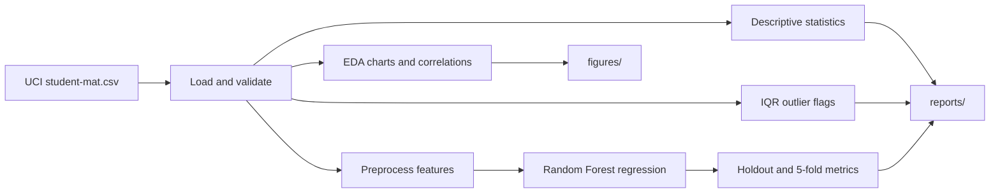
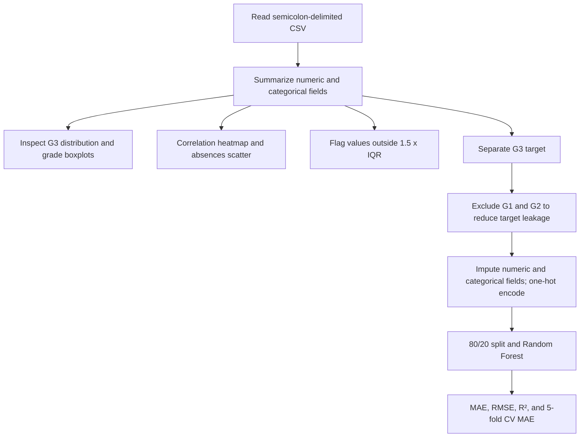
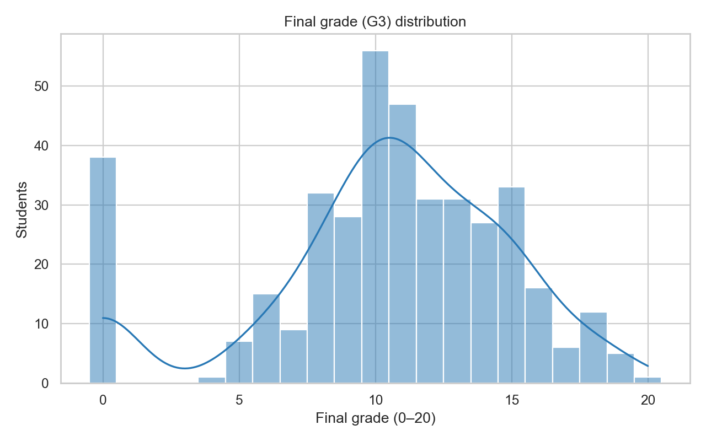
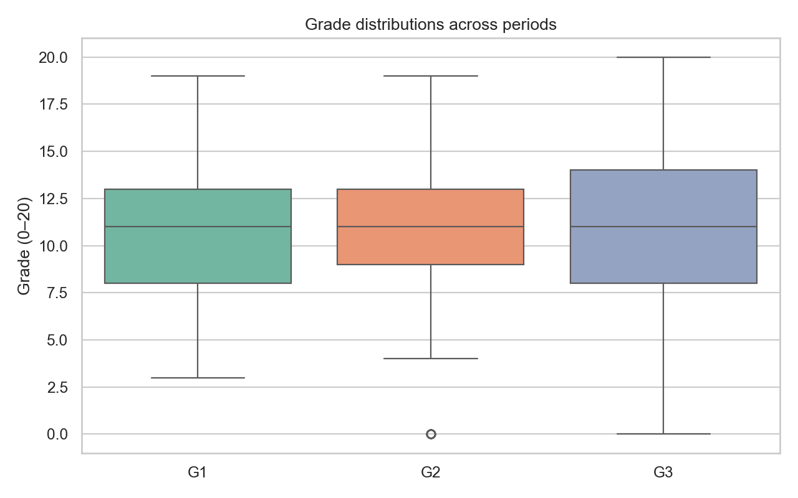
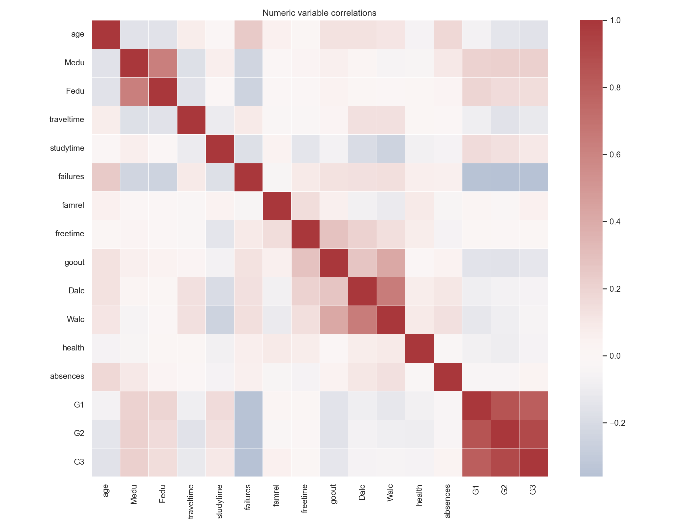
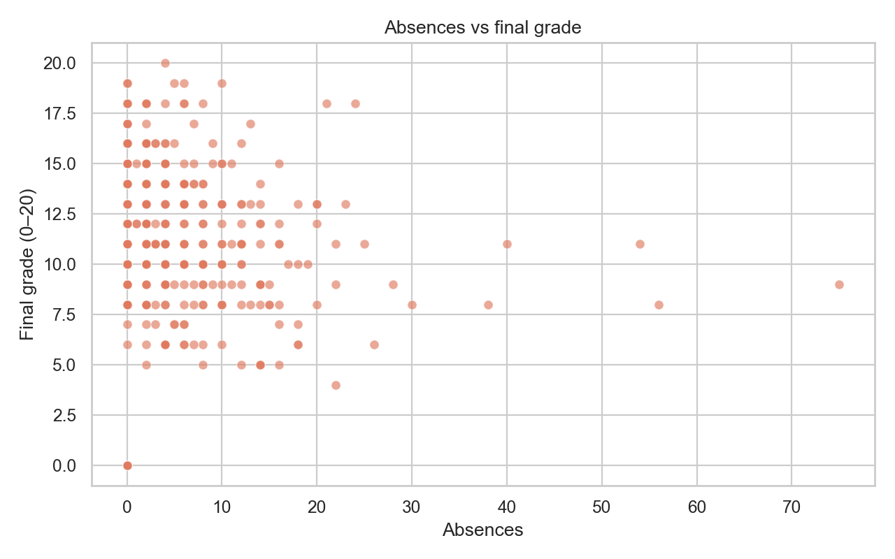

# Student Performance EDA and Prediction

End-to-end exploratory analysis of the **UCI Student Performance** mathematics dataset (`student-mat.csv`). The workflow computes descriptive statistics, visualizes grades and relationships, flags IQR outliers, and runs a Random Forest regression model for final grade (`G3`).

## Dataset

- Source: [UCI Machine Learning Repository — Student Performance](https://doi.org/10.24432/C5TG7T)
- Included file: Mathematics course, 395 student records and 33 fields (including `G3`). Grades use a 0–20 scale.
- The repository contains the UCI source file at `data/raw/student-mat.csv`; the Portuguese file is not included.

## Run

```bash
python -m pip install -r requirements.txt
python src/analyze.py
```

The script writes summary CSVs and model outputs to `reports/`, and plots to `figures/`. It is deterministic (`random_state=42`).

## Architecture



## Analysis flow



## Charts









## Outputs

- `reports/descriptive_statistics.csv`: count, mean, standard deviation, quartiles and range for numeric fields.
- `reports/all_variable_summary.csv`: summary of all fields, including categorical fields.
- `reports/missing_values.csv`: missing counts and percentages.
- `reports/outlier_summary_iqr.csv`, `reports/outlier_rows_iqr.csv`: IQR flags and affected records; values are retained rather than silently removed.
- `reports/model_metrics.json`, `reports/predictions.csv`, `reports/feature_importance.csv`: model evaluation and predictions.

## Interpreting outliers and model results

IQR outliers are statistical flags, not necessarily data errors. In particular, absences can be strongly right-skewed and include legitimate high-absence cases; zero grades may represent a real outcome or a special circumstance. Such cases can affect means, correlations, and a tree model's splits. Review flagged records in context before excluding or correcting them. The model is a baseline, and associations are not causal. This dataset is modest in size and tied to a specific school context, so performance should not be generalized to other schools without external validation.

Earlier period grades (`G1`, `G2`) are deliberately excluded because they are near-term proxies for the final grade and would inflate an early-intervention model. Compare this setup only with a clearly labeled late-term prediction use case if those grades are available at prediction time.

## Run results

The included run used all 395 mathematics records. Final grade (`G3`) has a mean of **10.42**, median **11**, and standard deviation **4.58** (out of 20); **38** records have a zero final grade. The strongest simple grade correlations are with `G2` (**0.905**) and `G1` (**0.801**), while past failures correlate negatively (**−0.360**). Study time has only a weak positive correlation (**0.098**) in this dataset; this does not estimate the causal effect of studying.

IQR screening flags **15** absence values (3.8% of rows). The highest outlier count is `failures` (83), which illustrates that the generic IQR rule can flag valid ordinal/count values in skewed or discrete fields. Treat the flags as review candidates, not errors to remove. High absence records may influence aggregate statistics and the fitted trees, while zero grades can strongly affect both the grade distribution and model error.

The leakage-aware Random Forest achieved test **MAE 3.03**, **RMSE 3.80**, **R² 0.295**, and mean 5-fold CV MAE **3.19**. These scores are a modest baseline, with errors measured in points on the 0–20 scale. The top feature importance in this run was absences, followed by past failures; feature importance describes how the fitted model uses predictors and does not establish cause.

Reproduce the results with `MPLCONFIGDIR=.mplconfig .venv/bin/python src/analyze.py` after installing `requirements.txt` (or use `python src/analyze.py` in an activated environment).

# Exploratory-Data-Analysis-of-Student-Performance
